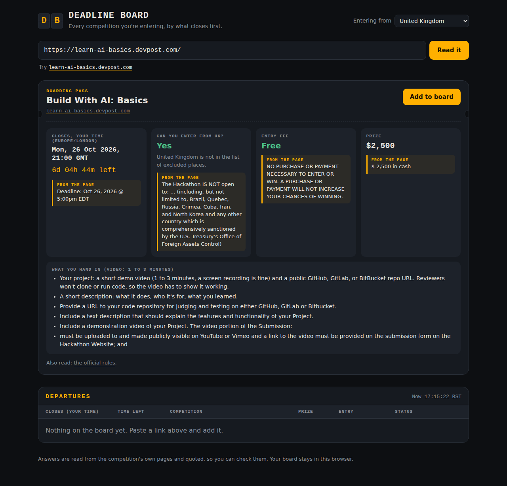
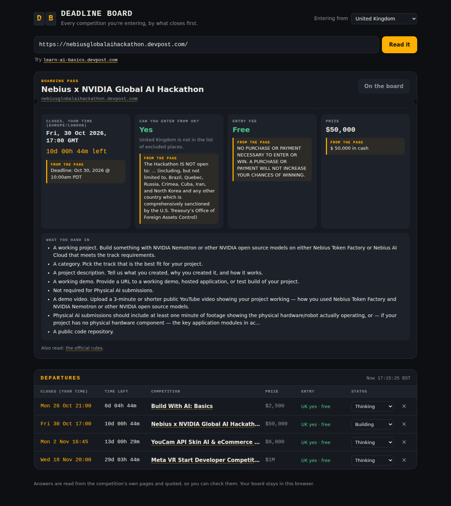

# Deadline Board

Paste a hackathon, contest or grant link. Get the four things that decide whether you enter:

- **When it closes, in your time**, with a live countdown
- **Whether you can enter from your country**
- **Whether it costs anything**
- **What you have to hand in**

Plus the prize. Under every answer is the line of the page it came from, so you can trust it or check it in one glance. Add competitions to a departures-style board sorted by what closes first, and mark each one thinking, building, submitted or skipped.




## Run it

Needs Node.js 20 or later. No installs, no keys.

```
node server.js
```

Then open http://localhost:8787.

## Test it

```
node --test tests/*.test.js
```

## How it reads a page

`lib/extract.js` holds plain reading rules, no AI model:

- **Deadline:** Devpost's machine-readable deadline, then structured data, then dated lines that mention a deadline, with a table of time zone names (PT, ET, UTC, GMT, BST, CET, IST, AoE and UTC±hh, with US daylight time worked out by date). A date with no time zone is shown as the earliest end of that day anywhere on earth, and the page says so.
- **Who can enter:** sentences about eligibility and lists of excluded countries, for the country you pick.
- **Fee:** "no purchase necessary", "free to enter", or an amount next to "entry fee" or "registration fee".
- **What to hand in:** the page's submission or requirements section.

For Devpost links it also reads the competition's `/rules` page, where eligibility and fees live.

When an answer isn't on the page it says "Not found on the page" rather than guessing.

## Privacy and safety

Your board lives in your browser's storage only. The server fetches only public web addresses (no private or local networks, checked again on every redirect), gives up after 12 seconds or 4 MB, and keeps nothing.

## Built with

Devpost Learn's Build With AI: Basics skill pack. The plan is in `devpost/`: `scope.md`, `prd.md`, `spec.md`, `checklist.md` and `app-map.html`.

## Licence

MIT
